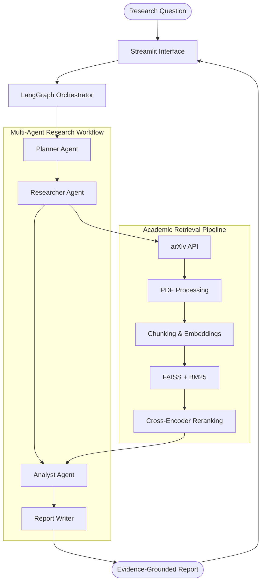

# DeepResearch-AI
### An Evidence-Grounded Multi-Agent AI Research Assistant

<p align="center">
  <b>Automating academic research through multi-agent orchestration, hybrid retrieval, and evidence-grounded reasoning.</b>
</p>

---

## Overview

DeepResearch-AI is an AI-powered research assistant designed to automate the academic research process.

It transforms research questions into structured reports by combining multi-agent orchestration, Retrieval-Augmented Generation (RAG), academic paper retrieval, and evidence-based analysis.

Rather than relying entirely on language model knowledge, the system retrieves relevant academic literature, extracts supporting passages, and uses those passages to generate evidence-grounded research reports.

The project integrates **LangGraph, Gemini, FAISS, BM25, Sentence Transformers, and Cross-Encoder reranking** into a modular research pipeline.

## Key Features

- **Multi-Agent Workflow:** Uses specialized agents for research planning, retrieval, analysis, and report generation.
- **Academic Paper Retrieval:** Searches academic literature through the arXiv API.
- **PDF Processing:** Extracts research paper content and metadata using PyMuPDF.
- **Hybrid Retrieval:** Combines FAISS-based semantic search with BM25 keyword retrieval.
- **Reciprocal Rank Fusion:** Combines semantic and keyword retrieval rankings.
- **Cross-Encoder Reranking:** Reorders retrieved passages based on query relevance.
- **Evidence-Grounded Analysis:** Uses retrieved academic passages to support research findings.
- **Citation-Aware Reports:** Includes source references based on retrieved paper metadata.
- **Interactive Interface:** Provides a Streamlit application for submitting research questions and viewing results.
- **Mock Mode:** Allows interface testing without making Gemini API calls.
- **Retrieval Evaluation:** Measures retrieval performance using Recall@K, MRR, and stage-level metrics.

## System Architecture



### Workflow

1. The user submits a research question through the Streamlit interface.
2. The Planner Agent creates a research plan.
3. The Researcher Agent retrieves academic papers and processes their content.
4. The retrieval pipeline combines semantic and keyword search.
5. Reciprocal Rank Fusion combines candidate rankings.
6. A Cross-Encoder reranks the retrieved passages.
7. The Analyst Agent synthesizes findings from the retrieved evidence.
8. The Report Writer generates a structured research report.
9. The final report and supporting evidence are displayed in the application.

LangGraph manages the research workflow and coordinates the individual agents.

## Technology Stack

| Technology | Purpose |
|---|---|
| Python 3.12 | Core development |
| LangGraph | Agent workflow orchestration |
| Google Gemini API | Research analysis and report generation |
| Streamlit | Interactive user interface |
| Sentence Transformers | Semantic text embeddings |
| FAISS | Vector similarity search |
| BM25 | Keyword-based retrieval |
| Reciprocal Rank Fusion | Hybrid ranking |
| Cross-Encoder | Passage reranking |
| arXiv API | Academic paper retrieval |
| PyMuPDF | PDF text extraction |
| Pydantic | Data validation |
| Pytest | Automated testing |

## Retrieval Evaluation

The retrieval pipeline is evaluated using a small benchmark of three research questions with manually assigned relevant paper IDs.

### Evaluation Results

| Metric | Result |
|---|---:|
| Candidate Recall | 0.8333 |
| Hybrid Recall@5 | 0.8333 |
| Reranked Recall@5 | 0.8333 |
| Mean Reciprocal Rank (MRR) | 0.6111 |

### Evaluation Methodology

- **Candidate Recall:** Measures how many known relevant papers are found during initial academic paper retrieval.
- **Hybrid Recall@5:** Measures relevant paper retrieval within the top five hybrid retrieval results.
- **Reranked Recall@5:** Measures relevant paper retrieval within the top five results after reranking.
- **MRR:** Measures how highly the first relevant result is ranked.

**Note:** These are preliminary results from a small benchmark. They should not be interpreted as evidence of general research accuracy or clinical reliability.

Citation and faithfulness evaluation are also part of the evaluation framework, with further validation required to establish semantic support between individual claims and their cited evidence.

## Project Structure

```text
DeepResearch-AI/
│
├── agents/
│   ├── planner.py
│   ├── researcher.py
│   ├── analyst.py
│   ├── report_writer.py
│   └── llm_client.py
│
├── graph/
│   └── research_workflow.py
│
├── ingestion/
│   ├── arxiv_loader.py
│   ├── pdf_processor.py
│   └── chunker.py
│
├── retrieval/
│   ├── embedding_model.py
│   ├── vector_store.py
│   ├── bm25_retriever.py
│   ├── hybrid_retriever.py
│   └── reranker.py
│
├── evaluation/
│   ├── benchmark.py
│   ├── retrieval_metrics.py
│   ├── citation_metrics.py
│   ├── faithfulness.py
│   ├── stage_metrics.py
│   ├── run_evaluation.py
│   └── results/
│
├── tests/
│
├── app.py
├── mock_workflow.py
├── requirements.txt
├── .env.example
├── .gitignore
└── README.md
```

## Getting Started

### Prerequisites

- Python 3.12
- Git
- Google Gemini API key

### 1. Clone the Repository

```bash
git clone https://github.com/akashdodda254/DeepResearch-AI.git
cd DeepResearch-AI
```

### 2. Create a Virtual Environment

```bash
py -3.12 -m venv venv
```

### 3. Activate the Environment

**Windows PowerShell:**

```powershell
.\venv\Scripts\Activate.ps1
```

### 4. Install Dependencies

```bash
python -m pip install -r requirements.txt
```

### 5. Configure Environment Variables

Create a `.env` file in the project root:

```env
GEMINI_API_KEY=your_gemini_api_key
```

Replace the placeholder with your own Gemini API key.

**Important:** Never commit your `.env` file or expose your API key publicly.

### 6. Run the Application

```bash
streamlit run app.py
```

Open the local URL displayed in your terminal to access the application.

### Mock Mode

The application includes a mock mode that displays sample research results without making Gemini API calls.

This is useful for testing the interface while conserving API usage.

## Testing

The project includes automated tests for selected components, including:

- Retrieval evaluation metrics
- Citation metric calculations
- Faithfulness review utilities
- Gemini client behavior using mocked responses
- Report generation components

Run the test suite with:

```bash
python -m pytest tests/ -v
```

## Current Limitations

- The research benchmark currently contains only three questions.
- Retrieval performance depends on the academic papers discovered by the arXiv search stage.
- Citation references are linked to retrieved source metadata; individual claims are not yet automatically verified against their cited passages.
- Faithfulness evaluation still requires further development and validation.
- The system is intended for research assistance, not as a substitute for expert review or clinical decision-making.

## Future Improvements

- [ ] Improve research question decomposition.
- [ ] Expand academic paper retrieval coverage.
- [ ] Introduce iterative retrieval based on evidence gaps.
- [ ] Implement automated claim-level citation verification.
- [ ] Improve answer faithfulness evaluation.
- [ ] Expand the research benchmark.
- [ ] Evaluate performance across different research domains.
- [ ] Improve report quality and evidence traceability.
- [ ] Deploy the Streamlit application publicly.

## Project Status

**Active Development**

The core research pipeline, multi-agent workflow, hybrid retrieval system, reranking pipeline, evaluation framework, and Streamlit interface have been implemented.

Development is ongoing, with a focus on improving retrieval quality, evidence verification, evaluation, and overall research reliability.

## Author

**Akash Dodda**

GitHub: [@akashdodda254](https://github.com/akashdodda254)

---

If you find this project interesting, consider giving it a ⭐ on GitHub!